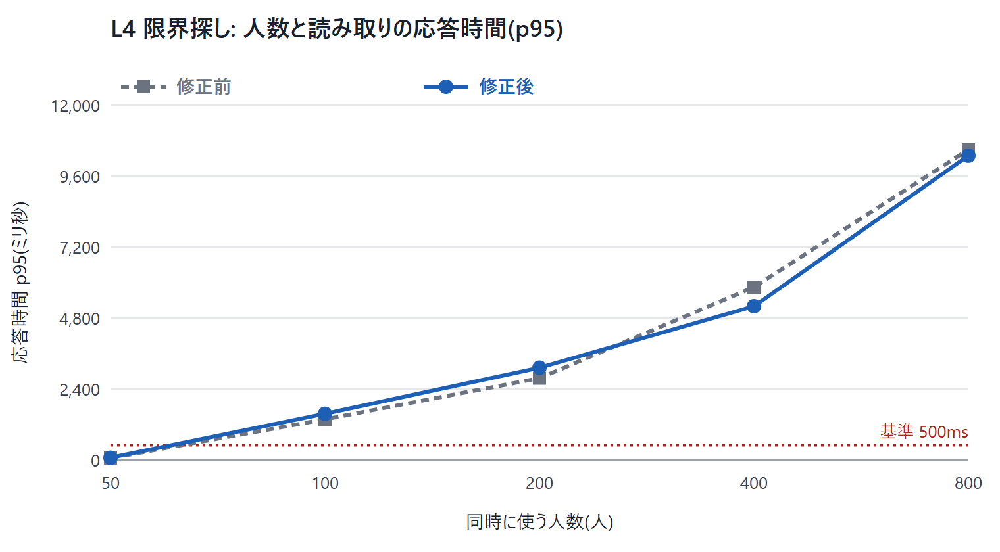
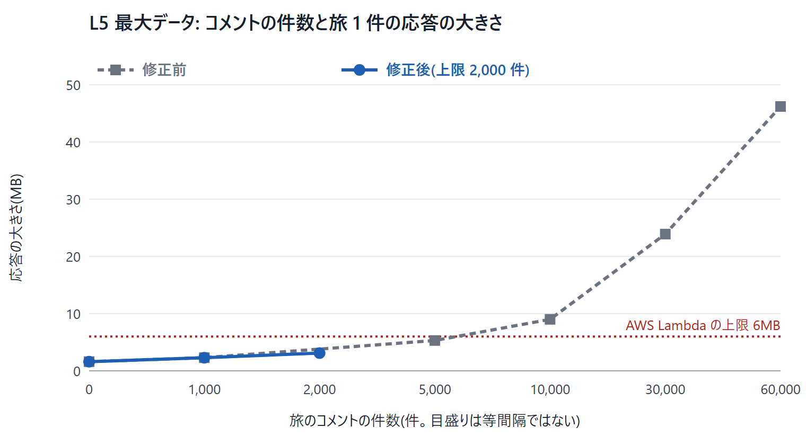

# Tri-Tri テスト結果報告書

> 実施: 2026-11-22〜2026-11-28。計画と合格基準は「テスト計画書」(計測の前に作成)。
> 対象のコード: ブランチ `feature/quality-check`(修正前は `2b123c6`)

## 1. まとめ

E2E テストと負荷試験で、**30 件の不具合**を見つけて直した。データが壊れる・他人の旅を読める、といった重大なものも含む。修正後は、負荷試験 8 項目のうち 7 項目が合格し、E2E は CI(Linux)の 4 環境ですべて合格した(Firefox の 2 件は理由つきで飛ばした。3.3)。

| 試験 | 修正前 | 修正後 |
|---|---|---|
| 単体・結合テスト | 334 件合格。足した不具合の再現テスト 17 件が失敗 | 362 件すべて合格 |
| E2E テスト(83 件 × 4 環境) | Chromium 70・スマートフォン幅 67・Firefox 57・WebKit 54 件合格 | CI(Linux): Chromium・WebKit・スマートフォン幅 85/85、Firefox 83/85(2 件は飛ばす) |
| 負荷試験 | 8 項目中 4 項目合格 | **8 項目中 7 項目合格** |

不合格のまま残ったのは **L2(100 人の通常の利用)の応答時間**だけ。エラーは 0 件だが、1 台のパソコンの 1 つの処理(Node.js)で API を動かす試験の条件では、毎秒約 85 件で処理が頭打ちになる。AWS では処理を自動で増やせるので、そこでの限界は別の所(5.3)にある。

## 2. 試験の環境
| 項目 | 内容 |
|---|---|
| パソコン | Intel Core i5-10310U(4 コア 8 スレッド、1.7GHz)、メモリ 16GB、Windows 11 Pro |
| 実行環境 | Node.js 24.20.0、Docker Desktop 29.8.1 |
| データベース | DynamoDB Local(Docker、メモリ上) |
| E2E | Playwright 1.65.1(Chromium・Firefox 159・WebKit・スマートフォン幅は Pixel 7 の画面)、axe-core 4.14.0 |
| 負荷試験 | k6 2.3.0(Docker)。負荷試験の専用の DB と API を別に立て、試験ごとに作り直した |

負荷をかける側(k6)と受ける側(API・DB)が同じパソコンで動いているため、**数値は AWS 上の性能を保証しない**。AWS の上限との比較は 5.3 に計算で示す。

## 3. E2E テスト

### 3.1 範囲
- 画面上のすべての操作(52 か所)にテストがある。変更する API 34 個のうち、修正前に画面から一度も通していなかった 14 個(退会、旅の変更・削除、抜ける、引き継ぎ、却下、招待の発行し直し・停止、公開の停止、予定・コメント・候補・投票・支出の削除)を足した
- 3 人で「作成 → 招待 → 計画 → 投票 → 割り勘 → 公開 → 引き継ぎ → 退会」を通す一連の流れ
- 失敗時(通信断、500・503・404・409・413)、入力の上限、二重押し、HTML の埋め込み(スクリプトが動かないこと)
- 見やすさ: axe の自動検査(WCAG 2.2 AA)をライト・ダークで全画面(Firefox を除く。3.3)、横のはみ出し、キーボードだけの一連の操作
- 2〜3 人で同時に使うリアルタイム更新(届く・今見ている人・編集中・切断と再接続)

### 3.2 結果
テストは 85 件(修正前は 83 件。後片付けを確かめる 2 件を後で足した)。表は「合格/実行した件数」。

**修正後: CI(Linux、GitHub Actions)。合否はこの結果で判断する**

| 環境 | 結果 | かかった時間 |
|---|---|---|
| Chromium | 85/85 | 6.1 分 |
| スマートフォン幅(Pixel 7) | 85/85 | 6.0 分 |
| Firefox | 83/85(2 件は飛ばす) | 6.5 分 |
| WebKit | 85/85 | 7.5 分 |

**修正後: 手元(Windows 11)**

| テスト | 内容 | Chromium | スマートフォン幅 | Firefox | WebKit |
|---|---|---|---|---|---|
| a11y | 見やすさ(axe・キーボード) | 3/3 | 3/3 | 1/3(2 件は飛ばす) | 2/3 |
| cleanup | テストの後片付け(テスト自体の確認) | 2/2 | 2/2 | 2/2 | 2/2 |
| errors | 失敗時・入力の確認・二重押し・状態 | 21/21 | 21/21 | 21/21 | 21/21 |
| form | 日付の入力・欄のそろい | 6/6 | 6/6 | 6/6 | 5/6 |
| journey | 一連の流れ(3 人) | 1/1 | 1/1 | 1/1 | 0/1 |
| operations | 全操作(旅程・候補・割り勘・メンバー・設定・退会) | 26/26 | 26/26 | 26/26 | 26/26 |
| realtime | リアルタイム更新 | 11/11 | 11/11 | 11/11 | 11/11 |
| suggest | 場所の候補(駅・バス停) | 4/4 | 4/4 | 4/4 | 4/4 |
| trip | 基本の流れ・公開しおり・地図 | 11/11 | 11/11 | 11/11 | 11/11 |
| **計** | | **85/85** | **85/85** | **83/85**(2 件は飛ばす) | **82/85** |

手元の WebKit の 3 件は、単独で流し直しても失敗し、CI(Linux)の WebKit では通る。Windows 版の WebKit だけの違い(Tab キーで届く部品、日付の欄への入力)と遅さによるもので、Safari が動く macOS・iPhone とは別物のため、合否は CI の結果で判断した。

**修正前: 手元(Windows 11)**

| テスト | 内容 | Chromium | スマートフォン幅 | Firefox | WebKit |
|---|---|---|---|---|---|
| a11y | 見やすさ(axe・キーボード) | 2/3 | 2/3 | 0/3 | 1/3 |
| errors | 失敗時・入力の確認・二重押し・状態 | 10/21 | 10/21 | 10/21 | 12/21 |
| form | 日付の入力・欄のそろい | 6/6 | 6/6 | 6/6 | 5/6 |
| journey | 一連の流れ(3 人) | 1/1 | 1/1 | 0/1 | 0/1 |
| operations | 全操作(旅程・候補・割り勘・メンバー・設定・退会) | 25/26 | 25/26 | 23/26 | 19/26 |
| realtime | リアルタイム更新 | 11/11 | 11/11 | 11/11 | 6/11 |
| suggest | 場所の候補(駅・バス停) | 4/4 | 4/4 | 0/4 | 3/4 |
| trip | 基本の流れ・公開しおり・地図 | 11/11 | 8/11 | 7/11 | 8/11 |
| **計** | | **70/83** | **67/83** | **57/83** | **54/83** |

### 3.3 わかったこと
- **Firefox だけで起きる不具合**を見つけた: 地名を貼り付けたり、変換を確定してまとめて入れたりすると、場所の候補が出なかった(1 文字ずつ打つと出る)。入れた値を親の画面の値から読み直していたため、Firefox では更新前の空の文字で探していた。Firefox の失敗 26 件のうち 20 件の原因。最初の修正では直りきらず、全環境の測り直しで見つけて原因を確かめ、直した
- **テストの後片付け漏れ**(テスト側の誤り): テストが開いたブラウザの画面を閉じていなかった。1 つのブラウザで続けて流す間に、画面とリアルタイム更新の接続が 100 を超えて溜まり、後のテストほど遅くなっていた。CI(Linux)の WebKit は 2 回とも途中で実行環境ごと止まった。各テストの後に、そのテストで開いた画面を閉じるようにし、それを確かめるテストを足した(直す前に失敗し、直した後に通ることを確かめた)
- Windows 版 WebKit はもともと遅く(1 件に数十秒〜数分)、時間切れが出やすい。WebKit の合否は CI(Linux)の結果で判断する
- **Playwright の Firefox で axe が落ちる**: 旅程から別のタブ(候補・割り勘など)へ移った後の画面で axe を動かすと、Firefox の画面の処理が落ちる(Windows・Linux とも)。保存した HTML を読み込ませると落ちず、ブラウザの記録にも理由が出ない。普通の操作では落ちない(Firefox でも候補・割り勘の操作のテストは通る)。アプリの不具合ではないと判断し、Firefox では全画面の axe の検査だけを飛ばした(理由はテストに書いた)。全画面の検査は Chromium・WebKit・スマートフォン幅で行っている
- Windows で Firefox を使うには、Playwright の部品確認(`msvcp140_1.dll`)を飛ばす必要があった(ブラウザ自体は動く)
- 足した 14 件の操作の中に、不具合が 4 件あった(4 章)

## 4. 負荷試験

### 4.1 結果の一覧
| # | 試験 | 合格基準 | 修正前 | 修正後 |
|---|---|---|---|---|
| L1 | 基準(1 人が全 API) | エラー 0 | 合格 | 合格 |
| L2 | 通常(100 人・10 分) | エラー 1% 未満、読み p95 500ms・書き p95 1 秒以内 | **不合格**(読み 1,558ms・書き 1,866ms) | **不合格**(読み 1,334ms・書き 1,589ms) |
| L3 | 集中(50 人が同じ旅) | 通知の欠け 0、読み直し完了まで p95 2 秒以内 | 合格(1,050ms) | 合格(1,473ms) |
| L4 | 限界探し(50〜800 人) | 合否なし | 50〜100 人の間 | 50〜100 人の間 |
| L5 | 最大データ | 応答 6MB 未満、読み・削除とも 29 秒以内 | **不合格**(48MB、削除 64 秒) | 合格(3.2MB、削除 0.05 秒) |
| L6 | 整合性(同時の操作 12 種) | 消失・二重・上限超え・精算のずれ 0 | **10/12**(リンクの同時発行で 500) | 合格(12/12) |
| L7 | 長時間(50 人・30 分) | 増え続けない、エラー 1% 未満 | 合格 | 合格 |
| L8 | 一斉再接続(50 人 × 5 回) | 10 秒以内に全員復帰、残骸 0 | 合格(最大 1.4 秒) | 合格(最大 1.4 秒) |

### 4.2 L2・L4: 通常の利用と限界
| 人数 | 修正前 読み p95 | 修正後 読み p95 | 修正後 処理量(件/秒) | エラー |
|---|---|---|---|---|
| 50 | 68ms | 79ms | 47 | 0 |
| 100 | 1,375ms | 1,563ms | 77 | 0 |
| 200 | 2,766ms | 3,120ms | 79 | 0 |
| 400 | 5,845ms | 5,198ms | 83 | 0 |
| 800 | 10,495ms | 10,292ms | 84 | 0 |



- 800 人でもエラーは 0 件。人数が増えると、待ち時間だけが延びる(処理を待つ列が長くなる)
- 詰まった場所は API の CPU(1 コアを使い切り、処理の遅れは最大 0.6 秒)。DB ではない
- CPU の使い道を記録したところ、アプリ自体の処理は約 1%。大半は DB 用の部品(AWS SDK)が応答を読む処理だった。そのうち、使っていないログのために毎回応答を整形していた約 6% を止めた(L2 の処理量は 77 → 87 件/秒)
- 50〜100 人の間で基準を超えるのは手元の条件(1 つの処理)による。AWS Lambda は同時の要求に応じて台数が増えるので、この頭打ちはそのまま当てはまらない。AWS 上で同じ試験をして確かめる必要がある

### 4.3 L3: 50 人が同じ旅を見ているとき
| 項目 | 修正前 | 修正後 |
|---|---|---|
| 変更の回数 | 150 回(2 秒に 1 回、5 分) | 150 回 |
| 届いた合図 | 7,500 / 7,500(欠け 0) | 7,500 / 7,500(欠け 0) |
| 変更から全員の読み直し完了まで | p95 1,050ms、最大 1,421ms | p95 1,473ms、最大 1,628ms |

修正後は、読み直しを「前回から 2 秒あけ、0.5 秒の幅でずらす」ようにした(5.3 の読み取り量を抑えるため)。そのぶん届くまでが少し延びたが、基準の 2 秒以内に収まった。

### 4.4 L5: 最大データ
| コメントの件数 | 応答の大きさ | 読む時間 | 読み取り容量(1 人) |
|---|---|---|---|
| 0 | 1.6MB | 0.4 秒 | 578 RCU |
| 1,000 | 2.4MB | 0.5 秒 | 779 RCU |
| 2,000(修正後の上限) | 3.2MB | 0.6 秒 | 979 RCU |
| 5,000(修正前のみ) | 5.5MB | 1.0 秒 | 1,582 RCU |
| 10,000(修正前のみ) | **9.4MB** | 1.6 秒 | 2,586 RCU |
| 60,000(修正前の上限) | **48MB** | 20 秒 | 12,630 RCU |

予定 300・候補 100(投票 5,000)・支出 500 件、文字数はすべて上限で測った。



- 修正前は、仕様の上限(予定 1 件に 200 件 × 予定 300 件 = 6 万件)まで入れると、AWS Lambda の応答の上限 6MB を約 7,000 件で超えた。旅全体のコメントを 2,000 件までにした(要件定義書を変更)
- 旅の削除は修正前 64 秒(API Gateway の 30 秒を超える)。開けなくした時点で応答し、残りの片付けは後で行うようにした: 応答 0.05 秒、片付けは 6.8 秒ですべて消えた

### 4.5 L6: 同時の操作
| 試験 | 結果(修正後) |
|---|---|
| 50 人が同じ予定を同時に更新 | 成功 1・衝突 49。成功した内容が残る |
| 予定・候補・支出・コメントの上限ちょうどへの駆け込み | 空き 25 件に 50 人: 成功 25・断り 25、上限ちょうど |
| 49 人の旅に 20 人を同時に承認 | 成功 10、50 人ちょうど |
| 全員が同時に 2 回ずつ投票 | 1 人 1 票 |
| 50 人が同時に採用 | 予定は 1 件だけ |
| 50 人が同時に支出を記録 | 50 件すべて残り、精算のずれ 0 円 |
| 招待・公開リンクの同時の発行し直し | 修正前は 20 回中 18〜19 回が 500。修正後は 500 なし、使えるリンクは 1 本 |

DynamoDB Local は書き込みを 1 つずつ処理するので、AWS で起きる「同時の書き込みの衝突」は起きない。その場合の動きは、衝突をわざと起こす結合テストで確かめた(5 章の 5〜10)。

### 4.6 L7・L8
- L7: 30 分間で 9 万回の操作と 4 万 5 千回の合図。エラー 0、使用メモリ(ヒープ)は 49〜60MB で横ばい、終了後の接続の残骸 0
- L8: 50 人 × 5 回の一斉再接続で、250 回すべてが 1.4 秒以内に復帰。残骸 0
- L8 の初回は 8 回失敗した。原因は試験の道具(Docker の中の k6)からパソコン側への接続が、Docker の中継で時間切れになったもので、アプリには届いていなかった。本物の画面と同じく「取れなければ 1 秒後にやり直す」動きを試験の道具に入れて測り直した

## 5. AWS の上限との比較
| 項目 | AWS の上限 | 修正前 | 修正後 |
|---|---|---|---|
| Lambda の応答の大きさ | 6MB | 48MB | 3.2MB |
| API Gateway の待ち時間 | 30 秒 | 64 秒(旅の削除) | 0.6 秒(最も遅い読み取り) |
| DynamoDB 1 パーティションの読み取り | 毎秒 3,000 RCU | 最大の旅 × 50 人で、変更 1 回に 63 万 RCU | 典型の旅(70KB)× 50 人で約 900 RCU/2 秒。**最大の旅 × 50 人では約 4.9 万 RCU/2 秒で、まだ超える** |
| DynamoDB 1 パーティションの書き込み | 毎秒 1,000 WCU | — | L3 で毎秒 0.5 回の変更(問題なし) |

## 6. 見つけた不具合と修正
「試験」は見つけた試験。直したものは、不具合を再現するテストを先に書いて失敗を確かめてから直し、同じ試験で確かめ直した。

| No | 優先度 | 内容 | 試験 | 直したこと |
|---|---|---|---|---|
| 1 | 高 | 退会した人が、旅を読めるし書き換えられる | 結合 | 退会した人の印を付けて旅を開けなくし、自分の一覧からも外した |
| 2 | 高 | 二重押しで支出・コメント・採用が 2 回登録される(精算額がずれる) | E2E | 送っている間はボタンを押せなくした |
| 3 | 高 | 大きな旅の応答が 6MB を超える(最大 48MB) | L5 | 旅全体のコメントを 2,000 件までにした |
| 4 | 高 | 大きな旅の削除に 64 秒かかる | L5 | 開けなくした時点で応答し、片付けは後で行う |
| 5 | 高 | 招待・公開リンクの同時の発行し直しで 500 | 結合・L6 | 読み直してやり直す |
| 6 | 高 | 同時の書き込みが続くと 500 | 結合 | 503(混み合っている)を返し、画面にも出す |
| 7 | 高 | 候補の削除が同時の書き込みとぶつかると 500 | 結合 | やり直すようにした |
| 8 | 高 | 退会と同時に引き継ぎ先が抜けると、退会した人がオーナーのまま | 結合 | 引き継げるまで次の人を試す |
| 9 | 高 | 日程の短縮と予定の追加・移動が重なると、日程の外に予定が残る(画面に出ない) | 結合 | 予定の配置の版を数え、変わっていたら読み直す |
| 10 | 高 | Firefox で、貼り付け・変換の確定で入れた地名に場所の候補が出ない | E2E(Firefox) | 入力欄から読んだ値でそのまま候補を探す(読み直さない) |
| 11 | 高 | 開発用 DB(認証なし)が同じネットワークの他の機器から見える | 点検 | このパソコンからだけつながる設定にした |
| 12 | 高(AWS) | 50 人の旅で変更のたびに全員が全件を読み直す | L5 の計算 | 読み直しを 2 秒あけ、ずらす(最大の旅では残る。5 章) |
| 13 | 中 | 抜ける操作と引き継ぎが重なると、抜けていないのに成功と返す | 結合 | 409 を返す |
| 14 | 中 | 抜けた人を含めて投票が 100 を超えた候補を消せない | 結合 | 投票は候補の削除の後で片付ける |
| 15 | 中 | 一度も無い件数(予定・支出)で、無いものを消すと 500 | 結合 | 404 を返す |
| 16 | 中 | 長すぎる ID で 500 | 結合 | DB に問い合わせずに 404 |
| 17 | 中 | 想定外の失敗が JSON でなく、画面が理由を出せない | 結合 | JSON で返し、内部の情報は出さない |
| 18 | 中 | 承認された直後に招待リンクが変わると、招待の画面で行き止まり | E2E | 旅の一覧へ案内する |
| 19 | 中 | 承認待ちで通信が一度切れると、戻っても誤りの表示が消えない | E2E | 読めたら消す |
| 20 | 中 | 旅の設定で、公開リンクの発行などをすると、保存前の入力が消える | E2E | 入力中の欄は読み直さない |
| 21 | 中 | 旅の設定が読めなかったとき、知らせが一瞬で消える | E2E | 画面に残る形で出す |
| 22 | 中 | 旅の一覧が、ほかのタブ・ほかの人の操作で増えた旅を出さない | E2E | 画面に戻ったときに読み直す |
| 23 | 中 | 予定を消すと、キーボードの位置が画面の先頭に飛ぶ | E2E | 本文の先頭に置く |
| 24 | 中 | 旅の最後の予定を「↓」で次の日へ動かせない | E2E | 最終日の最後だけ押せないようにした |
| 25 | 中 | ダークモードの削除ボタン(比 2.28)・件数(1.96)の文字、入力欄の枠(1.61・1.74)が薄い | axe・コントラスト | 基準を満たす色にした(8.50・9.44・4.30・5.47) |
| 26 | 中 | ログイン後の戻り先に「//よそのサイト」を指定すると、ログインに失敗する | E2E | このサイトの中だけを受け付ける |
| 27 | 低 | Windows でブランチを切り替えると、書き方の検査が失敗する | 点検 | 改行の扱いを決めるファイルを足した |
| 28 | 低 | 本番用ビルドと脆弱性検査が CI に無い。README が無い | 点検 | CI に足し、E2E も 4 環境で流す。README を作った |
| 29 | 低(性能) | 使っていないログのために、DB の応答を毎回整形している | L2 の記録 | 止めた(CPU 約 6%) |
| 30 | 低 | 済んだブランチが 3 本残っている | 点検 | 消した |

テスト側の誤り(アプリの不具合ではない)も直した: スマートフォン幅で地図が隠れる画面に合っていなかったテスト 3 件、Windows の WebKit のキー操作の違い、Safari がクリックでボタンにフォーカスを移さない違い、テストが開いた画面を閉じていなかったこと(3.3)。

## 7. 残っていること
| 項目 | 内容 | いつ |
|---|---|---|
| L2 の応答時間 | 手元の 1 つの処理では 100 人で基準を超える。AWS 上で測り直す | AWS への公開時 |
| 最大の旅の読み取り量 | 最大の大きさの旅を 50 人が見て変更が続くと、DB の 1 パーティションの読み取りの上限を超える。変わった所だけを読む方式などを検討する | AWS への公開時 |
| 旅の削除の後片付け | 手元は応答の後に行う。Lambda は応答の後に動けないので、今は片付けを待ってから応答する。後で動く仕組み(SQS など)へ移す | AWS への公開時 |
| 安定性の繰り返し | 計画では Chromium 10 回・ほか 3 回。手元では各 1〜2 回、CI(Linux)で 1 回(4 環境とも合格)。Firefox で 1 回だけ落ちた 3 件は、3 回ずつ流してすべて通った。残りの繰り返しは CI で重ねる | プッシュのたび |
| Firefox の axe | Playwright の Firefox が axe の実行中に落ちる件。Playwright・Firefox の更新のたびに、飛ばす設定を外して確かめ直す | 部品の更新時 |
| 実機 | iPhone・Android の実機では試していない | 公開時 |
| 本番のログイン | 会員登録・メールでのログインは未実装 | AWS への公開時 |
| 脆弱性 | 中程度 1 件(Nuxt のビルド用部品。アプリの動作には使われない)。部品の更新を待つ | 定期的に |

## 8. やり直し方
```sh
corepack pnpm test                                  # 単体・結合
corepack pnpm --filter @tritri/e2e test:all         # E2E(4 環境)
node load/run.mjs <名前> L1 L2 L3 L4 L5 L6 L7 L8    # 負荷試験(約 1.5 時間)
```
結果は `load/results/before`(修正前)と `load/results/after`(修正後)にある。
